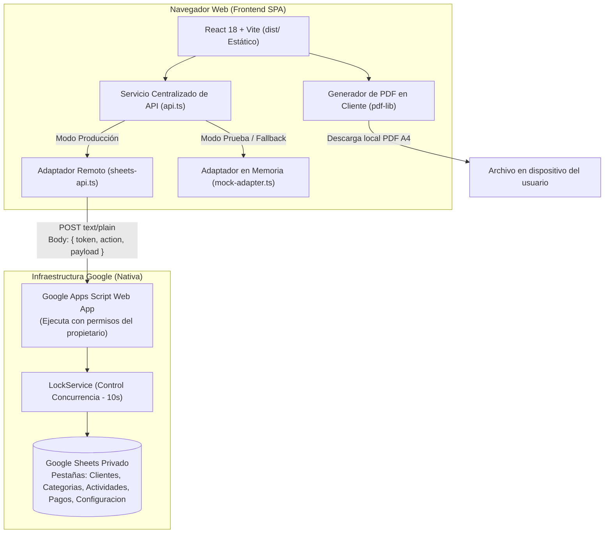

# Arquitectura Técnica del Sistema

## 1. Visión General de la Arquitectura

El sistema está diseñado bajo un modelo **Serverless / Backendless**, optimizado para operar con cero costos fijos de hosting y cero mantenimiento de servidores dedicados:

---

## 2. Decisiones de Arquitectura Fundamentales

### A. Frontend 100% Estático (SPA)
- **Tecnologías**: React 18, TypeScript 5, Vite 5, Tailwind CSS.
- **Compilación**: `npm run build` genera archivos HTML, JS y CSS puros dentro del directorio `dist/`.
- **Alojamiento**: Puede servirse desde cualquier proveedor estático (GitHub Pages, Cloudflare Pages, Netlify, Vercel) o ejecutarse localmente.
- **Sin SSR ni Servidor Node**: Al tratarse de una herramienta personal de productividad, no se agrega la sobrecarga de Server-Side Rendering ni frameworks de servidor como Next.js.
- **Carga Diferida de Módulos (Code Splitting)**:
  - La suite de generación de PDF (`pdf-lib`) se carga dinámicamente mediante `dynamic import()` únicamente cuando el usuario solicita la emisión del comprobante, manteniendo el bundle principal liviano (~75 kB gzipped).
  - La muestra visual del sistema de diseño (`UiGallery`) se separa en un chunk independiente accesible solo mediante el parámetro `?ui=1`.

### B. Persistencia y Gestión de Estado Dual
- La capa de datos en el cliente está centralizada en [`src/services/api.ts`](file:///C:/Users/djcha/Documents/Code/Ingresos/src/services/api.ts), la cual expone dos modos operativos:
  1. **Modo Producción (`sheets-api.ts`)**: Envía peticiones HTTP `POST` a la Web App de Google Apps Script vinculada a la hoja privada del propietario.
  2. **Modo de Prueba / Desarrollo (`mock-adapter.ts`)**: Adaptador completamente funcional en memoria que implementa el 100% del contrato de API y de cálculos de negocio, activado automáticamente si las variables de entorno no están configuradas o si la Web App no está disponible.

---

## 3. Seguridad, Autenticación y Límites de Acceso

### Comparativa: Enfoque Conceptual vs Enfoque Implementado

| Criterio | Decisión Conceptual Inicial | Arquitectura Real Implementada |
| :--- | :--- | :--- |
| **Mecanismo de Acceso** | Autorización de Google desde el navegador (OAuth 2.0 / GIS). | Web App de Google Apps Script con token de acceso personal. |
| **Ejecución de Persistencia** | El navegador interactúa con la API de Google Sheets usando token OAuth del usuario. | La Web App de Apps Script se ejecuta con los permisos del propietario ("Ejecutar como: Yo"). |
| **Gestión de Credenciales** | Requiere configurar OAuth Client ID en Google Cloud Console y consent screen. | Solo requiere configurar `AUTH_TOKEN` en las *Script Properties* de Google Apps Script. |
| **Ventajas Técnicas** | Autenticación formal con identidad de Google. | Menor fricción, cero configuración en Google Cloud Console, lógica de validación centralizada en Apps Script antes de escribir en Sheets. |

### Limitación de Seguridad Documentada

> [!WARNING]
> **Naturaleza del Token en Bundles Estáticos**:
> Cualquier variable con prefijo `VITE_*` (`VITE_APPS_SCRIPT_URL`, `VITE_APP_AUTH_TOKEN`) se compila directamente en el código JavaScript de la SPA. Por tanto, el token de aplicación es visible para quien inspeccione el bundle en el navegador.
> 
> Este mecanismo funciona como un control de acceso para **uso personal privado**, pero **no constituye un secreto criptográfico robusto ni autenticación multiusuario**. Si en el futuro la aplicación requiriera ser compartida con terceros o expuesta públicamente, será indispensable introducir un backend intermedio con autenticación de identidad.

---

## 4. Concurrencia, Rendimiento y Límites de Google Sheets

| Factor / Desafío | Magnitud Real | Estrategia de Mitigación Implementada |
| :--- | :--- | :--- |
| **Cuota de peticiones** | 300 peticiones / minuto por proyecto | El uso de un único trabajador independiente genera un tráfico típico inferior a 20 peticiones por minuto. |
| **Condiciones de Carrera (Race conditions)** | Múltiples escrituras simultáneas en Sheets | `LockService.getScriptLock()` en `Code.gs` adquiere un bloqueo exclusivo de hasta 10 segundos antes de modificar filas. |
| **Idempotencia y Reintentos** | Pérdida de conexión o timeouts durante escrituras | Operaciones `createClient`, `createActivity` y `addPayment` generan un `request_id` único con huella criptográfica persistido en la misma fila. Reintentos con idéntico contenido devuelven el registro original sin duplicar. |
| **Latencia de escritura** | 400 ms a 1.500 ms por invocación a Apps Script | La interfaz implementa retroalimentación inmediata, botones deshabilitados y estados de carga visibles para prevenir dobles envíos. |
| **Identificadores estables** | Reordenamiento o filtrado de filas en la hoja | Toda entidad genera claves primarias con prefijo semántico + UUID (`cli_...`, `act_...`, `cat_...`, `pay_...`). Jamás se depende de la posición física de la fila. |
| **Restricciones de ContentService** | Apps Script no permite asignar códigos de estado HTTP (4xx / 5xx) | Todos los errores y éxitos se transmiten en un sobre JSON estructurado (`success: boolean`, `data`, `error: { code, message }`). El cliente interpreta dicho sobre. |
| **Generación de PDF** | Alto consumo de memoria y cuota si se procesara en Apps Script | La generación del documento se realiza **100% en el cliente** mediante `pdf-lib`. |
