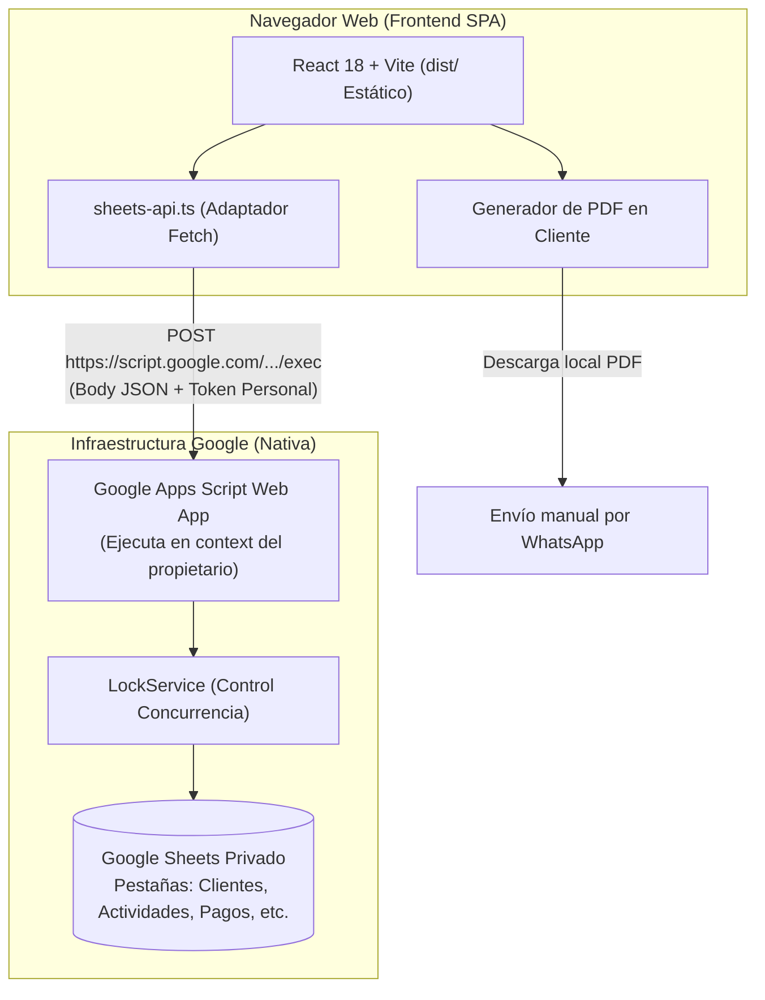

# Arquitectura Técnica del Sistema

## 1. Visión General de la Arquitectura

El sistema está diseñado bajo un modelo **Serverless / Backendless**, optimizado para la máxima ligereza, cero costos de hosting de servidores y cero mantenimiento de infraestructura:

---

## 2. Decisiones de Arquitectura Fundamentales

### A. Frontend 100% Estático (SPA)
- **Tecnologías**: React 18, TypeScript 5, Vite 5, Tailwind CSS.
- **Compilación**: `npm run build` genera archivos HTML, JS y CSS puros dentro de la carpeta `dist/`.
- **Despliegue**: Puede alojarse en cualquier CDN estático (GitHub Pages, Cloudflare Pages, Netlify, Vercel) o incluso abrirse localmente.
- **Sin SEO / Sin SSR**: Al ser una herramienta privada de uso personal, no se añade la complejidad de Server-Side Rendering ni frameworks de servidor como Next.js.

### B. Persistencia Privada mediante Google Apps Script Web App
- Se optó por una Web App de Google Apps Script vinculada a la hoja de cálculo por las siguientes ventajas determinantes:
  1. **Cero servidores propios**: No hay necesidad de mantener procesos Node.js en Railway/Render/VPS.
  2. **Hoja 100% privada**: La hoja de cálculo **nunca se comparte públicamente**. Solo el script del propietario tiene acceso a leer y modificar los datos.
  3. **Cero exposición de credenciales privadas**: En el navegador del usuario **nunca** se almacenan llaves privadas de Google Cloud Console ni secretos de cuentas de servicio. Solo se utiliza un token de aplicación personal.
  4. **Autoridad de cálculo**: La lógica crítica (validación de sobrepagos, cálculo de saldos y consistencia) se ejecuta del lado de Google antes de escribir en las filas.

---

## 3. Seguridad y Acceso Personal

Dado que la aplicación es para un **único usuario propietario**:
- La Web App de Apps Script se despliega como "Ejecutar como: Yo" y "Acceso: Cualquier usuario".
- La seguridad se implementa a nivel de código en el manejador `doPost`:
  - Se valida el campo `token` recibido contra la propiedad `AUTH_TOKEN` almacenada en las *Script Properties* de Google Apps Script.
  - Peticiones con tokens ausentes o incorrectos reciben el error JSON `UNAUTHORIZED`.
  - La URL del Web App y el `AUTH_TOKEN` se configuran en el `.env` del frontend (`VITE_APPS_SCRIPT_URL` y `VITE_APP_AUTH_TOKEN`).

  > **Limitación de seguridad documentada:** cualquier valor `VITE_*` se incorpora al bundle estático y puede extraerse desde el navegador. El token de aplicación no es un secreto robusto ni autentica una identidad; CORS no lo sustituye. Esta arquitectura se conserva para el uso personal aprobado, no debe confundirse con protección para datos expuestos públicamente. Si se requiere protección frente a terceros, hay que revisar la arquitectura para autenticar en un servidor antes de publicar datos personales. No almacenar credenciales privadas de Google en el frontend.

  Apps Script `ContentService` no permite asignar un estado HTTP personalizado a las respuestas; los errores se interpretan mediante `success` y `error.code` del sobre JSON.

---

## 4. Concurrencia, Rendimiento y Límites de Google Sheets

| Límite / Desafío | Magnitud Real de Sheets | Estrategia de Mitigación en la Arquitectura |
| :--- | :--- | :--- |
| **Cuota de peticiones** | 300 peticiones / minuto por proyecto | Para un único usuario independiente, el consumo típico no superará 10 a 20 peticiones por minuto. |
| **Condiciones de Carrera (Race conditions)** | Múltiples escrituras simultáneas pueden sobrescribir filas | `LockService.getScriptLock()` en `Code.gs`. Adquiere un bloqueo exclusivo de hasta 10 segundos antes de modificar la hoja. |
| **Latencia de escritura** | 300 ms a 1.200 ms por llamada a Apps Script | La UI debe implementar estados de carga visibles (*loaders*, botones deshabilitados) y retroalimentación inmediata al usuario. |
| **Identificadores estables** | Reordenar o filtrar filas en Sheets corrompe IDs basados en fila | Cada entidad genera un identificador UUID con prefijo (`cli_...`, `act_...`, `pay_...`) en la columna 1. El número de fila nunca se usa como clave foránea. |
| **Generación de PDF** | Procesar binarios pesados en Apps Script consume memoria y cuota | La generación del documento se realiza **100% en el navegador del cliente** con los datos estructurados devueltos por la API. |
